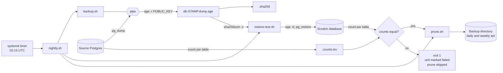

# encrypted-supabase-backups

[](https://github.com/midcityhandyman/encrypted-supabase-backups/actions/workflows/ci.yml)

**The problem:** your business runs on a hosted Postgres database (Supabase or any other). One bad migration, one deleted project or one closed account and the customer, job and invoice records are gone. Most teams have a backup somewhere. Few have ever restored one.

**Who it is for:** a small team that wants its own copy of the data, encrypted, and wants to know each morning that last night's copy actually restores.

**What it does, every night:**

1. Takes a full dump of your database and encrypts it before it reaches the disk.
2. Restores that dump into a throwaway database and checks that every table came back with the same number of rows it had at backup time.
3. Only if that check passes, deletes backups that are older than your retention rule.

If the restore check fails, the job exits non-zero, nothing is deleted, and the failure is logged. You hold the files and the key; no third party service is involved.

The tooling is four small Bash scripts around `pg_dump`, [age](https://age-encryption.org) encryption and a systemd timer. 26 tests, and a CI job that runs the whole cycle against a real Postgres 16 server with real age. It has not yet been run against a live Supabase project; see [Limitations](#limitations).

## What you will see

Captured from `bash demo/run-demo.sh` (full output in [`demo/output.txt`](demo/output.txt)). The demo runs offline against a stand-in database with 16 made-up rows, so the numbers are tiny on purpose. A good night:

```text
[backup] backup written: db-20261111T021500Z.dump.age (386 bytes, 3 tables, 16 rows)
[restore-test] checksum ok
[restore-test] decrypting and restoring into scratch database restore_test_scratch
[restore-test]   ok        public.customers expected=5 restored=5
[restore-test]   ok        public.invoices expected=3 restored=3
[restore-test]   ok        public.jobs expected=8 restored=8
[restore-test] RESTORE TEST PASSED for db-20261111T021500Z.dump.age: 3 tables match
[prune] prune done: 4 kept, 7 removed (daily=3 weekly=2)
[nightly] nightly cycle complete
```

A night where the restore quietly lost one row:

```text
[restore-test]   MISMATCH  public.jobs expected=8 restored=7
[restore-test] ERROR: RESTORE TEST FAILED for db-20261111T021500Z.dump.age: row counts differ (tolerance 0)
restore-test exit code: 1
```

## The scripts

| Script | Job |
| --- | --- |
| `bin/backup.sh` | `pg_dump` piped straight into `age`. Plaintext never touches the disk. Writes the encrypted dump, a `.sha256` checksum and a `.counts.tsv` file holding the exact row count of every table at backup time. |
| `bin/restore-test.sh` | Verifies the checksum, decrypts into a scratch database, counts rows per table and compares them with the recorded counts. Exits non-zero on any difference, missing table or extra table. Always drops the scratch database. |
| `bin/prune.sh` | Retention. Keeps the newest backup of each of the last `KEEP_DAILY` days and each of the last `KEEP_WEEKLY` ISO weeks. Has a `--dry-run`. |
| `bin/nightly.sh` | Runs the three in order: backup, restore test, prune. |

Design choices worth knowing:

- **The backup step only needs the age public key.** A host that only takes backups cannot read them.
- **Nothing half written is ever kept.** The dump goes to a `.partial` file and is renamed only after `pg_dump` and `age` both exit zero (`pipefail`). There is also a size floor, `BACKUP_MIN_BYTES`; its default of 64 bytes is smaller than an age header, so it only catches an empty file until you raise it to something near your normal dump size.
- **Pruning runs only after the new backup has passed its restore test.** A bad night never pushes good history out of the retention window.
- **Retention counts days that have backups, not calendar days.** If the job stalls for a month, the old backups do not age out.
- **The restore test refuses to use the source database, or the admin database, as its scratch target.** The check is by database name, and it rejects connection strings it cannot read a database name from.
- **Schema scoped.** `BACKUP_SCHEMAS` defaults to `public`, which leaves Supabase's own managed schemas (auth, storage and so on) out of the dump. What that means for restoring a Supabase database is under Limitations.

## Architecture



## Run it

Needs Linux, Bash 4+, GNU coreutils, `pg_dump`/`pg_restore`/`psql` matching your server version, and [age](https://age-encryption.org).

```bash
age-keygen -o age-identity.txt          # prints the public key; keep this file safe and off the backup host if you can
cp .env.example backup.env              # then edit: database URLs, the public key, the backup directory
BACKUP_ENV_FILE=backup.env bin/nightly.sh
```

Database passwords belong in `~/.pgpass` (or `PGPASSFILE`), not in the env file.
To run it every night, copy the two example units in `systemd/` and enable the timer.
Each script also runs on its own, for example `bin/prune.sh --dry-run` or `bin/restore-test.sh path/to/backup.dump.age`.

To restore for real, the same two commands the test uses:

```bash
age -d -i age-identity.txt db-20261111T021500Z.dump.age \
  | pg_restore --clean --if-exists --no-owner --no-privileges --dbname="$TARGET_URL"
```

## Demo

```bash
bash demo/run-demo.sh
```

Runs offline with no server and no keys: about a minute under Git Bash on Windows, quicker on Linux. It seeds a stand-in database with synthetic rows, takes ten nights of backups, runs the full nightly cycle on night eleven, then walks through three failure drills (a lost row, the wrong key, a file modified after it was written). In the demo the Postgres tools are always stubs, and age is a stub unless the real binary is installed. The captured output in [`demo/output.txt`](demo/output.txt) came from a run with both stubbed.

## Tests

```bash
bash tests/run.sh            # all tests
bash tests/run.sh prune      # only tests whose name contains "prune"
```

The suite is plain Bash with no framework to install. It has 26 tests covering the happy path, a failed dump, a refused overwrite, input validation, a lost row, a missing table, a corrupt file, the wrong key, the scratch database guard, connection strings the guard cannot read, every retention rule, the executable bits recorded in git and the full nightly cycle.

### What ran where

| Part | Development machine (Windows, Git Bash) | GitHub Actions (Ubuntu 24.04) |
| --- | --- | --- |
| `tests/run.sh` (26 tests) | Ran, all passed. Postgres tools were **stubs** and age was a **stub**, because neither is installed there. | Runs twice: stubbed in the `unit` job, and with the real `age` binary in the `full-cycle` job. |
| `demo/run-demo.sh` | Ran. Same stubs. Output matches `demo/output.txt` byte for byte. | Runs in the `unit` job. |
| `shellcheck` | Not installed; not run locally. | Runs in the `unit` job at warning level. |
| `ci/full-cycle.sh` against real Postgres 16 and real age | **Not run.** No Postgres client tools or age on the machine. | Runs in the `full-cycle` job against a Postgres 16 service container. |
| systemd units | **Not run.** | **Not run.** Written as examples; never installed or started anywhere. |
| A live Supabase project | **Not run.** | **Not run.** |

The badge at the top shows whether both CI jobs pass on the current commit. `ci/full-cycle.sh` seeds four small tables (2,350 synthetic rows) plus a second schema that must stay out of the dump, runs the nightly cycle, then asserts the file has an age header, holds no plaintext, the oldest backup was pruned, the counts match and the scratch database is gone. It also checks three failures: a count mismatch, the wrong key and an unreachable source.

The stubs live in `tests/stubs/`. The Postgres stubs treat a directory as a database and a TSV file as a table, and understand only the exact commands the scripts send. The age stub is **not encryption**: it gzips and base64 encodes behind an envelope that names the recipient and refuses a non matching identity. The stubbed tests prove the control flow, the file handling and the comparison logic. Only the `full-cycle` CI job proves that a real `pg_dump` restores on a real server and that the row count SQL is valid.

## Configuration

All settings are environment variables; see [`.env.example`](.env.example). The required ones are `SOURCE_DATABASE_URL`, `AGE_RECIPIENT` and `BACKUP_DIR` for the backup, plus `SCRATCH_ADMIN_URL` and `AGE_IDENTITY_FILE` for the restore test. For Supabase, use the direct connection or the session pooler; `pg_dump` does not work through the transaction pooler.

## Where this pattern comes from

This is a cleaned up, generic version of a pattern drawn from systems that run two small service companies day to day, where the database holds the customer, job and invoice records the business cannot operate without. The code here was written fresh for publication and contains no data, names or configuration from those systems. This repo itself has only been run in tests, the demo and CI.

## Limitations

What has and has not been run:

- **Never run against a live Supabase project, or any hosted database.** The only real server it has met is a stock Postgres 16 container in CI, as a superuser, with four small tables.
- **Never run under systemd.** The two unit files are examples that have not been installed or started.
- **No timing or size figures.** It has not been run on a large database, so there is no measured backup or restore duration to quote.
- **Locally, everything is stubbed.** The stub Postgres is a directory of TSV files and the stub age is not encryption. The demo output above comes from those stubs.

What the design does not do:

- **Row counts are a smoke test, not a content check.** A restore with the right number of wrong rows would pass. Checksumming table contents would catch that and is not implemented.
- **Counts and dump are separate transactions.** The counts are taken just before `pg_dump` starts, so a write landing in between makes them differ by a few rows on a busy database. `ROW_COUNT_TOLERANCE` (rows per table, default 0) exists for that; sharing one exported snapshot between the two would be the proper fix.
- **Exact counts scan every table.** Fine for small and medium databases, slow on very large ones.
- **The count sidecar is not encrypted.** It reveals table names and row counts to anyone who can read the backup directory.
- **Only the chosen schemas are backed up.** With the default, Supabase auth users, storage metadata, roles, grants and row level security role mappings are not in the dump.
- **A Supabase `public` schema will probably not restore into a bare Postgres as is.** Policies that name the `authenticated` or `anon` roles or call `auth.uid()`, foreign keys to `auth.users`, and extensions all point at things a plain scratch server does not have, and the restore test stops on the first error. Expect to prepare the scratch server (roles, an `auth` schema, extensions) before the nightly check goes green. This setup is not scripted here.
- **Running the restore test on the backup host means the private key lives there too,** which gives up the "backup host cannot decrypt" property. Run `restore-test.sh` on a separate machine if that matters to you.
- **No off-site copy.** The scripts write to a local directory. Shipping the encrypted files elsewhere (object storage, another host) is left to you, and a backup that lives only on one disk is not finished.
- **No alerting built in.** Failure is a non-zero exit and a line in `restore-test.log`; wire `OnFailure=` or your own monitor to it.
- **Linux and GNU tools.** `prune.sh` uses GNU `date -d`. macOS needs coreutils installed.
- **Connection strings for the restore test must be `postgres://` URLs that name a database.** The keyword form (`host=... dbname=...`) is rejected there.

License: MIT, see the LICENSE file.
