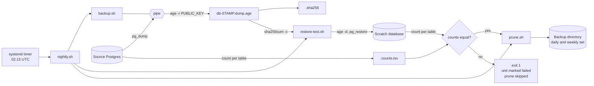

# encrypted-supabase-backups

A managed Postgres (Supabase or any other) is one bad migration or one closed account away from being gone, and a backup nobody has restored is only a hope.
This repo takes a nightly encrypted dump you hold yourself and proves every night that it restores.

## What it does

Four small Bash scripts, no daemon, no database of their own:

| Script | Job |
| --- | --- |
| `bin/backup.sh` | `pg_dump` piped straight into `age`. Plaintext never touches the disk. Writes the encrypted dump, a `.sha256` checksum and a `.counts.tsv` file holding the exact row count of every table at backup time. |
| `bin/restore-test.sh` | Verifies the checksum, decrypts into a scratch database, counts rows per table and compares them with the recorded counts. Exits non-zero on any difference, missing table or extra table. Always drops the scratch database. |
| `bin/prune.sh` | Retention. Keeps the newest backup of each of the last `KEEP_DAILY` days and each of the last `KEEP_WEEKLY` ISO weeks. Has a `--dry-run`. |
| `bin/nightly.sh` | Runs the three in order: backup, restore test, prune. |

Design choices worth knowing:

- **The backup step only needs the age public key.** A host that only takes backups cannot read them.
- **Nothing half written is ever kept.** The dump goes to a `.partial` file and is renamed only after `pg_dump` and `age` both exit zero (`pipefail`) and the file passes a minimum size check.
- **Pruning runs only after the new backup has passed its restore test.** A bad night never pushes good history out of the retention window.
- **Retention counts days that have backups, not calendar days.** If the job stalls for a month, the old backups do not age out.
- **The restore test refuses to use the source database, or the admin database, as its scratch target.**
- **Schema scoped.** `BACKUP_SCHEMAS` defaults to `public`, which leaves Supabase's own managed schemas (auth, storage and so on) out of the dump so it restores into a plain Postgres.

## Architecture



## Run it

Needs Bash 4+, GNU coreutils, `pg_dump`/`pg_restore`/`psql` matching your server version, and [age](https://age-encryption.org).

```bash
age-keygen -o age-identity.txt          # prints the public key; keep this file safe and off the backup host if you can
cp .env.example backup.env              # then edit: database URLs, the public key, the backup directory
BACKUP_ENV_FILE=backup.env bin/nightly.sh
```

Database passwords belong in `~/.pgpass` (or `PGPASSFILE`), not in the env file.
To run it every night, copy the two example units in `systemd/` and enable the timer.
Each script also runs on its own, for example `bin/prune.sh --dry-run` or `bin/restore-test.sh path/to/backup.dump.age`.

To restore for real, the same two commands the test uses:

```bash
age -d -i age-identity.txt db-20261111T021500Z.dump.age \
  | pg_restore --clean --if-exists --no-owner --no-privileges --dbname="$TARGET_URL"
```

## Tests

```bash
bash tests/run.sh            # all tests
bash tests/run.sh prune      # only tests whose name contains "prune"
```

The suite is plain Bash with no framework to install. It has 24 tests covering the happy path, a failed dump, a refused overwrite, input validation, a lost row, a missing table, a corrupt file, the wrong key, the scratch database guard, every retention rule and the full nightly cycle.

### What ran where

This is the honest split between what was run on the development machine and what only runs in CI.

| Part | Development machine | GitHub Actions |
| --- | --- | --- |
| `tests/run.sh` (24 tests) | Ran, all passed. Postgres tools were **stubs** and age was a **stub**, because neither `pg_dump` nor `age` was installed. | Runs twice: stubbed in the `unit` job, and with the real `age` binary in the `full-cycle` job. |
| `demo/run-demo.sh` | Ran. Same stubs. Output saved in `demo/output.txt`. | Runs in the `unit` job. |
| `shellcheck` | Ran (0.11.0), clean at warning level. | Runs in the `unit` job. |
| `ci/full-cycle.sh` against real Postgres 16 and real age | **Not run.** No Postgres server, Docker or age on the machine. | Runs in the `full-cycle` job against a Postgres service container. |
| systemd units | **Not run.** Written as examples; not installed or started anywhere as part of this repo. | Not run. |

The stubs live in `tests/stubs/`. The Postgres stubs treat a directory as a database and a TSV file as a table, and understand only the exact commands the scripts send. The age stub is **not encryption**: it gzips and base64 encodes behind an envelope that names the recipient and refuses a non matching identity. They prove the control flow, the file handling and the comparison logic. They do not prove that `pg_dump` output restores on a real server or that the row count SQL is valid. That is what the `full-cycle` CI job is for, and until that job has gone green on GitHub, the real Postgres path is unverified.

## Demo

```bash
bash demo/run-demo.sh
```

Runs offline in a few seconds with no server and no keys. It seeds a fake database with synthetic rows, takes ten nights of backups, runs the full nightly cycle on night eleven, then walks through three failure drills. The captured output is in [`demo/output.txt`](demo/output.txt). The core of it:

```text
[backup] backup written: db-20261111T021500Z.dump.age (386 bytes, 3 tables, 16 rows)
[restore-test] checksum ok
[restore-test] decrypting and restoring into scratch database restore_test_scratch
[restore-test]   ok        public.customers expected=5 restored=5
[restore-test]   ok        public.invoices expected=3 restored=3
[restore-test]   ok        public.jobs expected=8 restored=8
[restore-test] RESTORE TEST PASSED for db-20261111T021500Z.dump.age: 3 tables match
[prune] keep    db-20261111T021500Z.dump.age (daily+weekly)
[prune] keep    db-20261108T021500Z.dump.age (weekly)
[prune] removed db-20261107T021500Z.dump.age
```

And a restore that silently lost one row:

```text
[restore-test]   MISMATCH  public.jobs expected=8 restored=7
[restore-test] ERROR: RESTORE TEST FAILED for db-20261111T021500Z.dump.age: row counts differ (tolerance 0)
restore-test exit code: 1
```

## Configuration

All settings are environment variables; see [`.env.example`](.env.example). The required ones are `SOURCE_DATABASE_URL`, `AGE_RECIPIENT` and `BACKUP_DIR` for the backup, plus `SCRATCH_ADMIN_URL` and `AGE_IDENTITY_FILE` for the restore test. For Supabase, use the direct connection or the session pooler; `pg_dump` does not work through the transaction pooler.

## Where this pattern runs

This is a cleaned up, generic version of a pattern drawn from systems that run two small service companies day to day, where the database holds the customer, job and invoice records the business cannot operate without. The code here was written fresh for publication and contains no data, names or configuration from those systems.

## Limitations

- **Row counts are a smoke test, not a content check.** A restore with the right number of wrong rows would pass. Checksumming table contents would catch that and is not implemented.
- **Counts and dump are separate transactions.** The counts are taken just before `pg_dump` starts, so a write landing in between makes them differ by a few rows on a busy database. `ROW_COUNT_TOLERANCE` (rows per table, default 0) exists for that; sharing one exported snapshot between the two would be the proper fix.
- **Exact counts scan every table.** Fine for small and medium databases, slow on very large ones.
- **The count sidecar is not encrypted.** It reveals table names and row counts to anyone who can read the backup directory.
- **Only the chosen schemas are backed up.** With the default, Supabase auth users, storage metadata, roles, grants and row level security role mappings are not in the dump. Tables that depend on extensions or roles missing from the scratch server will fail to restore until you create them there.
- **Running the restore test on the backup host means the private key lives there too,** which gives up the "backup host cannot decrypt" property. Run `restore-test.sh` on a separate machine if that matters to you.
- **No off-site copy.** The scripts write to a local directory. Shipping the encrypted files elsewhere (object storage, another host) is left to you, and a backup that lives only on one disk is not finished.
- **No alerting built in.** Failure is a non-zero exit and a line in `restore-test.log`; wire `OnFailure=` or your own monitor to it.
- **Linux and GNU tools.** `prune.sh` uses GNU `date -d`. macOS needs coreutils installed.
- **Verification gap:** as stated above, the real Postgres and real age path has only been written for CI, not executed locally.

License: MIT, see the LICENSE file.
